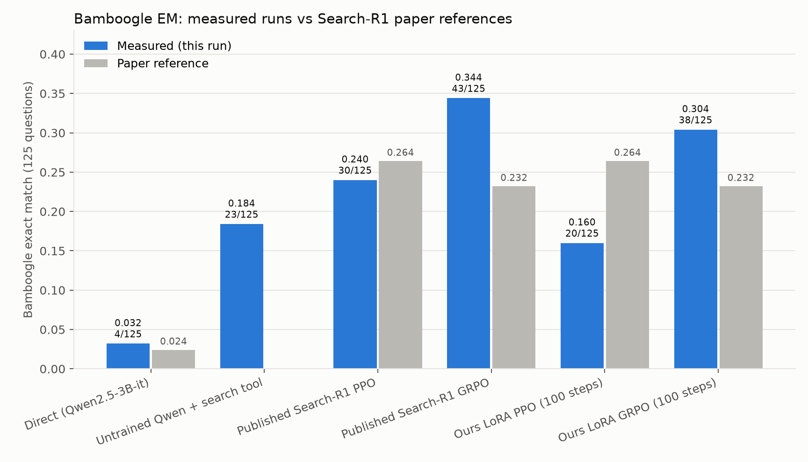
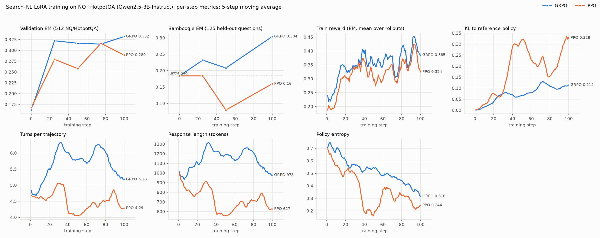

# neu-self-improve-ai

Coursework for INFO7375 (self-improving AI).

## Assignment 5 — Search-R1 with PEFT (`week_08/search_r1`)

Replication of [Search-R1](https://arxiv.org/abs/2503.09516) on
Qwen2.5-3B-Instruct with LoRA, comparing GRPO and PPO on the 125-question
Bamboogle set. Start with:

- [`week_08/search_r1/REPLICATION_REPORT.md`](week_08/search_r1/REPLICATION_REPORT.md) — background, protocol, results, limitations
- [`week_08/search_r1/RUNBOOK.md`](week_08/search_r1/RUNBOOK.md) — exact commands used on the GB300 node
- [`week_08/search_r1/results/RESULTS.md`](week_08/search_r1/results/RESULTS.md) — generated result tables
- LoRA adapters: GRPO/PPO checkpoints at steps 25/50/100 (step 100 = final) under
  `week_08/search_r1/results/runs/*-main/adapter-step*/lora_adapter/`; smoke and tiny-zero adapters are listed in
  [`week_08/search_r1/README.md`](week_08/search_r1/README.md#lora-adapter-weights)

| Bamboogle EM (125 questions) | Measured | Paper |
| --- | ---: | ---: |
| Direct inference | 0.032 | 0.024 |
| Untrained Qwen2.5-3B-Instruct + search tool | 0.184 | — |
| Published Search-R1 PPO checkpoint | 0.240 | 0.264 |
| Published Search-R1 GRPO checkpoint | 0.344 | 0.232 |
| Ours: LoRA GRPO, 100 steps | 0.304 | (0.232, full FT) |
| Ours: LoRA PPO, 100 steps | 0.160 | (0.264, full FT) |

